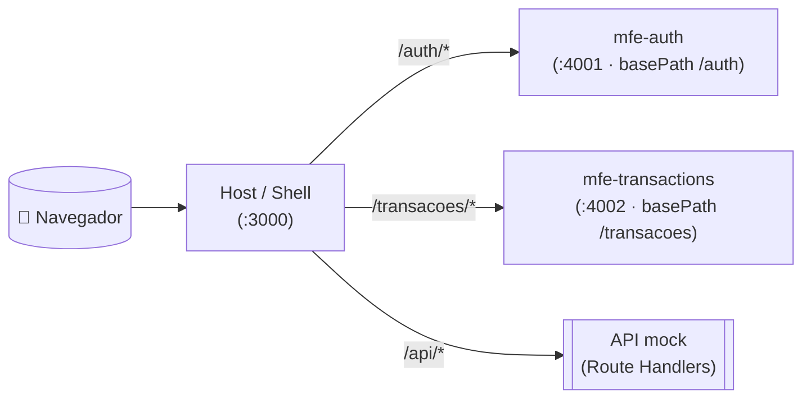

`PÓS TECH: FRONT-END ENGINEERING/2026`
<h1>
  
  Projeto FinanceApp
</h1>

Aplicação de gerenciamento financeiro, com o objetivo de oferecer uma interface intuitiva que permita aos usuários controlar e gerenciar suas transações financeiras de forma eficiente.

Nesta fase, a aplicação evoluiu para uma arquitetura de **Microfrontends** usando **Next.js Multizones**: um _shell_ (host) que integra dois microfrontends independentes (autenticação e transações), além de uma API _mock_ servida pelo próprio host.

<br>

## Integrantes
* [Gisele Cardoso](https://github.com/Gisele-Cardoso)
* [Guilherme Neves Trindade](https://github.com/Guilhermeneves142)
* [Tayane Milagres](https://github.com/taymilagres)
* [Vandrei de Lima](https://github.com/vandreilima)

<br>

## 🌐 Acesse online

🔗 **Aplicação:** [tech-challenge-one.vercel.app](https://tech-challenge-one.vercel.app/)

> **Credenciais de teste:** `joao@financeapp.com` / `123456`
> _(os dados na nuvem persistem em um Redis gerenciado — Upstash)_

<br>

##  Composição geral
* Login, Cadastro e Recuperação de senha
* Home / Dashboard com widgets e gráficos
* Listagem de transações com filtros
* Modais de adição, edição e remoção de registros de transações

<br>

## Tecnologias utilizadas

* **Desenvolvimento:** Next.js 16, React 19, TypeScript, Tailwind, shadcn/cn
* **Microfrontends:** Next.js Multizones (proxy via `rewrites`)
* **Dados no cliente (cache/requisições):** TanStack React Query v5 (`useQuery`, `useMutation`, scroll infinito e invalidação de cache)
* **Estado global:** Redux Toolkit (MFE de transações)
* **Gráficos:** Recharts
* **Layout do dashboard:** react-grid-layout (widgets arrastáveis)
* **Performance:** `next/dynamic` (lazy loading de gráficos e modais) + `loading.tsx` por rota
* **Segurança:** sessão em cookie `httpOnly` com token assinado (HMAC-SHA256) e senhas com hash `scrypt`
* **Dados:** API _mock_ via Route Handlers do Next (`/api`) · persistência em **Upstash Redis** (produção) ou `mock/db.json` (local/Docker)
* **Containerização:** Docker + Docker Compose
* **Design System:** Figma
* **Documentação de componentes:** Storybook

<br>

## 🧩 Arquitetura (Microfrontends · Multizones)

A aplicação é composta por **3 repositórios** independentes. O host faz o _proxy_ das
zonas via `rewrites` no [`next.config.ts`](./next.config.ts), de modo que o usuário
navega tudo a partir de uma **única URL** (a do host).



| App | Porta (dev) | Papel | Repositório |
|---|---|---|---|
| **Host / Shell** | `3000` | Layout, dashboard, proxy das zonas e **API em `/api`** | [tech-challenge](https://github.com/Guilhermeneves142/tech-challenge) |
| **mfe-auth** | `4001` | Login, cadastro, recuperar senha (`/auth`) | [tech-challenge-mfe-auth](https://github.com/Guilhermeneves142/tech-challenge-mfe-auth) |
| **mfe-transactions** | `4002` | Transações (`/transacoes`) | [tech-challenge-mfe-transactions](https://github.com/Guilhermeneves142/tech-challenge-mfe-transactions) |

> A API _mock_ deixou de ser um `json-server` externo e passou a viver no host como
> Route Handlers em `src/app/api`. Em local/Docker ela persiste em `mock/db.json`;
> na nuvem (serverless) persiste no **Upstash Redis** (o FS da Vercel é somente
> leitura, então o "banco" vive numa chave do Redis, inicializada com o seed).

<br>

## Arquitetura de pastas (host)
```bash
TECH-CHALLENGE/
├── mock/                       # db.json (seed dos dados / banco local)
├── scripts/                    # seed-db.mjs (sobe o db.json p/ o Redis)
├── src/
│   ├── app/
│   │   ├── (main)/             # área autenticada (dashboard, etc.)
│   │   │   └── dashboard/
│   │   ├── api/[...path]/      # API mock (mini json-server)
│   │   └── layout.tsx
│   ├── components/             # componentes do shell
│   ├── features/               # dashboard-widgets, etc.
│   ├── lib/                    # clientes de API e utilidades
│   ├── server/                 # acesso a dados server-only (SSR)
│   ├── shared/  ·  store/  ·  styles/
│   └── proxy.ts                # auth guard (middleware)
├── Dockerfile · docker-compose.yml · DOCKER.md
└── next.config.ts              # rewrites das zonas (multizone)
```
<br>

##  Demonstração
🔗 **Vídeo de demonstração:** [Video](https://www.youtube.com/watch?v=G0iU-HV3PUs)
<br>
🔗 **Design System:** [Figma](https://www.figma.com/design/3U3w8niWGklunFZzrSCGto/Tech-Chalenger?node-id=52-1791&t=ZNWD9qu4LBWp7f2j-0)

<br>

## ♿ Acessibilidade

A interface segue boas práticas de acessibilidade (a11y) para funcionar bem com
teclado e leitores de tela:

* **HTML semântico:** uso de `header`, `nav`, `main`, `section`, `article` e
  listas (`ul`/`li`) em vez de `div` genérica sempre que há significado estrutural.
* **Navegação:** o menu lateral é uma lista de links dentro de `nav`, e o item da
  rota atual é marcado com `aria-current="page"`.
* **Controles interativos:** ações sempre usam `button`/`a` reais (nunca `div`
  clicável). Itens desabilitados usam `<button disabled>`, mantendo o estado
  acessível por teclado e leitores de tela.
* **Ícones:** ícones decorativos recebem `aria-hidden`; botões só com ícone têm
  `aria-label` descritivo (ex.: "Sair", "Abrir menu", "Editar widget").
* **Formulários:** todo campo tem `<Label htmlFor>` associado; mensagens de erro
  usam `role="alert"` para serem anunciadas por leitores de tela.
* **Menu mobile:** o botão de abrir/fechar expõe `aria-expanded` e `aria-controls`.

> Os componentes base vêm da lib `@vandrei/finance-ui` (modais com _focus trap_,
> foco visível), e o Storybook inclui o addon `@storybook/addon-a11y` para
> auditar componentes isoladamente.

<br>

## ▶️ Como rodar localmente

#### _Pré-requisitos:_
* Node.js >= 22.14
* npm ou yarn
* Os **3 repositórios clonados lado a lado** (o host orquestra os MFEs):

```
faculdade/
├── tech-challenge/            # este repositório (host)
├── mfe-auth/
└── mfe-transactions/
```

> ⚠️ **Os nomes das pastas importam!** Os scripts do host (`npm run dev`) e o
> Docker procuram os MFEs em `../mfe-auth` e `../mfe-transactions`. Como os
> repositórios no GitHub têm outro nome (`tech-challenge-mfe-*`), clone
> passando o nome da pasta de destino, como abaixo.

```bash
# Clone os 3 repositórios na mesma pasta (repare no 2º argumento do clone)
git clone https://github.com/Guilhermeneves142/tech-challenge.git
git clone https://github.com/Guilhermeneves142/tech-challenge-mfe-auth.git mfe-auth
git clone https://github.com/Guilhermeneves142/tech-challenge-mfe-transactions.git mfe-transactions

# Instale as dependências de cada um
npm install --prefix tech-challenge
npm install --prefix mfe-auth
npm install --prefix mfe-transactions

# (opcional) variáveis de ambiente do host — veja a tabela abaixo
cd tech-challenge
echo 'AUTH_SECRET=troque-por-uma-string-aleatoria-com-32+-caracteres' > .env.local

# A partir do host, suba tudo (host + 2 MFEs) de uma vez
npm run dev

# Abra o link do host (Ctrl + clique)
http://localhost:3000
```

| Porta | App |
|---|---|
| `3000` | host (shell + API `/api`) |
| `4001` | mfe-auth (`/auth`) |
| `4002` | mfe-transactions (`/transacoes`) |

**React Query:** não precisa de configuração extra — o `QueryClientProvider` já está
em `src/app/providers.tsx` de cada app e os hooks ficam em `src/lib/queries/`
(`transactions.ts`, `widgets.ts`, `auth.ts`). Em dev, os MFEs incluem o
`@tanstack/react-query-devtools` para inspecionar o cache no navegador.

#### Variáveis de ambiente (host)

| Variável | Para quê | Padrão |
|---|---|---|
| `AUTH_SECRET` | segredo que assina o token de sessão (**defina em produção**) | valor inseguro de dev |
| `MFE_AUTH_URL` / `MFE_TX_URL` | URLs das zonas | `localhost:4001` / `:4002` |
| `UPSTASH_REDIS_REST_URL` / `_TOKEN` | persistência em produção | `mock/db.json` |

> **Login de teste:** `joao@financeapp.com` / `123456`.

<br>

## 🔐 Segurança

* **Sessão:** o login define um cookie `httpOnly` (+ `Secure` em produção, `SameSite=Lax`)
  com um token assinado por HMAC-SHA256 e expiração de 7 dias. O token **não é mais
  guardado em `localStorage`** nem exposto ao JavaScript, o que mitiga roubo por XSS.
* **Auth guard:** `src/proxy.ts` valida a assinatura/expiração do token (não basta o
  cookie existir) e a API `/api` responde `401` sem sessão válida.
* **Dados sensíveis:** senhas são armazenadas com hash `scrypt` + salt (senhas
  legadas em texto puro são migradas no primeiro login); `password` nunca é
  retornado pela API e o recurso `users` não é exposto pelo CRUD genérico.
* **Usuário logado:** vem de `GET /api/auth/me`; logout via `POST /api/auth/logout`
  (o servidor invalida o cookie).

<br>

## ⚡ Performance

* `next/dynamic` nos gráficos (`WidgetChart`/Recharts) e nos modais (widget,
  exclusão, transação), carregados só quando necessários.
* `loading.tsx` por rota (`/dashboard`, `/em-construcao`, telas de auth e
  transações) para feedback imediato durante a navegação.

<br>

## 🐳 Como rodar com Docker

O projeto inteiro sobe em **um único container** (modo desenvolvimento). Requer Docker
Desktop e os 3 repositórios lado a lado.

```bash
# A partir da pasta tech-challenge
docker compose up --build

# Abra
http://localhost:3000
```

📄 Passo a passo completo em **[DOCKER.md](./DOCKER.md)**.

<br>

## ☁️ Deploy (Vercel)

🔗 **No ar:** [tech-challenge-one.vercel.app](https://tech-challenge-one.vercel.app/)

Como cada zona é independente, o deploy são **3 projetos na Vercel** (host + 2 MFEs).
A Vercel faz o **build nativo do Next.js**, o Docker acima é só para rodar/testar
local, **não** é usado no deploy.

| Projeto | O que serve |
|---|---|
| **host** | a aplicação (ponto de entrada) + a API em `/api` |
| **mfe-auth** | a zona `/auth` |
| **mfe-transactions** | a zona `/transacoes` |

No projeto do **host**, as URLs das zonas vêm das variáveis de ambiente (ou dos
_defaults_ de produção no `next.config.ts` quando rodando na Vercel):

```bash
MFE_AUTH_URL = https://<seu-mfe-auth>.vercel.app
MFE_TX_URL   = https://<seu-mfe-transactions>.vercel.app
```

O host lê essas variáveis nos `rewrites()` e faz o _proxy_ das zonas, por isso o
usuário acessa **tudo pela URL do host**. A API _mock_ (`/api`) também roda no host
(serverless).

Como o filesystem da Vercel é somente leitura, a persistência em produção usa o
**[Upstash Redis](https://upstash.com/)** (free tier). No projeto do host, configure
também:

```bash
UPSTASH_REDIS_REST_URL   = https://<seu-db>.upstash.io
UPSTASH_REDIS_REST_TOKEN = <token da seção REST API do console Upstash>
```

Na primeira requisição, o banco é inicializado automaticamente com o seed do
`mock/db.json`. Para resetar os dados de produção com o seed do repositório:
`npm run db:seed` (requer as mesmas variáveis no `.env.local`). Passo a passo
completo em **[DOCKER.md](./DOCKER.md)**.

<br>

## Como acessar o Storybook dos componentes
#### _Pré-requisitos:_
* Ter o repositório clonado na sua máquina
* Todas as dependencias do projeto instaladas _(conforme citado acima)_

```bash

# Abra o terminal e rode o comando abaixo
npm run storybook

# Abra o link disponibilizado no terminal (Ctrl + clique)

```
